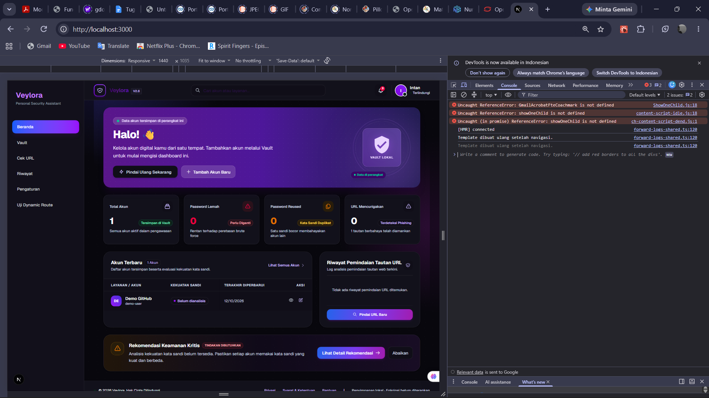
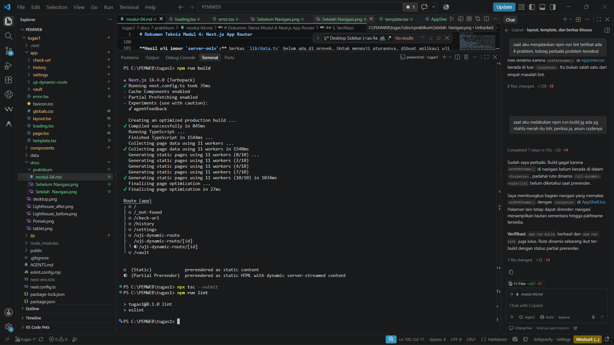

# Dokumen Teknis Modul 4: Next.js App Router 

Nama/NIM   : Intan Rhevita Arselina Suryana/105224009
Repositori : 105224009_Veylora
Versi Next.js dan mode Cache Components (aktif/tidak) : Next.js 16.4.0, akti

## 1. Peta Rute- Tabel: URL, berkas di app/, jenis rute, isi halaman
- Potongan tabel rute dari keluaran npm run build 
## 1. Peta Rute

| URL                       | Berkas di `app/`                      | Jenis Rute | Isi Halaman                                   |
| ------------------------- | ------------------------------------- | ---------- | --------------------------------------------- |
| `/`                       | `app/page.tsx`                        | Statis     | Halaman utama aplikasi Veylora.               |
| `/check-url`              | `app/check-url/page.tsx`              | Statis     | Halaman untuk memeriksa keamanan URL.         |
| `/history`                | `app/history/page.tsx`                | Statis     | Halaman riwayat pemeriksaan URL.              |
| `/settings`               | `app/settings/page.tsx`               | Statis     | Halaman pengaturan aplikasi.                  |
| `/vault`                  | `app/vault/page.tsx`                  | Statis     | Halaman pengelolaan informasi akun.           |
| `/uji-dynamic-route`      | `app/uji-dynamic-route/page.tsx`      | Statis     | Halaman untuk menguji navigasi rute dinamis.  |
| `/uji-dynamic-route/[id]` | `app/uji-dynamic-route/[id]/page.tsx` | Dinamis    | Halaman pengujian berdasarkan parameter `id`. |


## 2. Layout, Template, dan Berkas Khusus
- Pohon folder app/ akhir
app/
├── favicon.ico
├── globals.css
├── layout.tsx
├── page.tsx
├── check-url/
│   └── page.tsx
├── history/
│   └── page.tsx
├── settings/
│   └── page.tsx
├── uji-dynamic-route/
│   ├── page.tsx
│   └── [id]/
│       └── page.tsx
└── vault/
    └── page.tsx

- Hasil uji layout vs template (tangkapan layar sebelum dan sesudah navigasi)
| Aspek         | Sebelum navigasi                          | Setelah navigasi                                 |
| ------------- | ----------------------------------------- | ------------------------------------------------ |
| Halaman       | Beranda (`/`)                             | Vault (`/vault`)                                 |
| Header        | Menampilkan header Veylora                | Header Veylora tidak terlihat pada halaman Vault |
| Sidebar       | Navigasi menu terlihat                    | Navigasi menu tetap terlihat                     |
| Konten utama  | Dashboard Beranda                         | Daftar akun Vault                                |
| Pesan Console | `Template dibuat ulang setelah navigasi.` | Pesan yang sama muncul kembali                   |



- Tangkapan layar loading.tsx dan error.tsx (mode dev dan produksi) 
uji coba sendiri la ya bang, susah kali ss nya tinggal npm run dev aja
sumpah cape kali ini bang begulat sama sodaraku

## 3. Rute Dinamis dan Validasi params

Rute dinamis menggunakan berkas `app/uji-dynamic-route/[id]/page.tsx`, sehingga nilai segmen `[id]` dibaca sebagai parameter `id`. Pengujian HTTP dilakukan pada server development yang berjalan di `localhost:3000`.

| URL | Hasil yang diharapkan | Hasil aktual | Kode status `curl` |
| --- | --- | --- | --- |
| `/uji-dynamic-route/akun-123` | Halaman detail menampilkan ID `akun-123` dan status berhasil. | Halaman detail tampil dan ID `akun-123` diterima. | `200` |
| `/uji-dynamic-route/id%21` | Parameter yang mengandung `!` ditolak dan pesan `ID Tidak Valid` ditampilkan. | Halaman menampilkan pesan `ID Tidak Valid`. | `200` |
| `/uji-dynamic-route/` | Tanpa parameter ID, pengguna diarahkan ke halaman pengujian rute. | URL diarahkan ke `/uji-dynamic-route` dan halaman pengujian tampil. | `200` (setelah redirect) |
| `/uji-dynamic-route/` + ID 101 karakter | ID melebihi batas 100 karakter dan ditolak dengan pesan `ID Tidak Valid`. | Halaman menampilkan pesan `ID Tidak Valid`. | `200` |

Status `200` pada parameter tidak valid terjadi karena validasi dilakukan di komponen halaman sisi klien dan menampilkan pesan kesalahan; validasi tersebut tidak mengubah status HTTP menjadi `4xx`. Untuk kasus tanpa ID, `curl -L` mengikuti pengalihan dari URL dengan garis miring di akhir.

Contoh perintah pengujian:

```powershell
curl.exe -i http://localhost:3000/uji-dynamic-route/akun-123
curl.exe -i http://localhost:3000/uji-dynamic-route/id%21
curl.exe -L -i http://localhost:3000/uji-dynamic-route/
$id = "a" * 101
curl.exe -i "http://localhost:3000/uji-dynamic-route/$id"
```

Aturan validasi parameter `id` adalah:

- Nilai harus berupa satu segmen URL dan bertipe string.
- Panjang ID yang diterima adalah 1 sampai 100 karakter.
- Karakter yang diperbolehkan hanya huruf ASCII (`a-z` atau `A-Z`), angka (`0-9`), tanda hubung (`-`), dan garis bawah (`_`).
- Nilai kosong, karakter lain seperti `!` atau `.`, dan ID lebih dari 100 karakter dianggap tidak valid. Halaman detail menampilkan pesan `ID Tidak Valid`.
- Form uji menerima ID langsung atau URL/path yang berakhir dengan ID; setelah validasi, aplikasi membuka `/uji-dynamic-route/[id]`.

## 4. Pembagian Server dan Client Components

| Komponen/berkas | Jenis | Alasan teknis |
| --- | --- | --- |
| `app/layout.tsx` | Server Component | Tidak memakai `"use client"`. Berkas ini mengatur HTML, metadata, font, dan membungkus halaman dengan `AppShell`. |
| `app/loading.tsx` | Server Component | Tidak memakai `"use client"` dan hanya menampilkan tampilan saat halaman sedang dimuat. |
| `app/error.tsx` | Client Component | Memakai `"use client"`, `useEffect`, dan tombol `Coba Lagi` yang menjalankan fungsi `reset`. |
| `app/template.tsx` | Client Component | Memakai `"use client"` dan `useEffect` untuk mencatat saat template dibuat ulang setelah navigasi. |
| `app/page.tsx`, `app/check-url/page.tsx` | Client Components | Memakai state dan interaksi formulir; halaman utama juga memakai `usePathname`. |
| `app/history/page.tsx`, `app/settings/page.tsx`, `app/vault/page.tsx` | Client Components | Memakai state/effect untuk mengelola tampilan dan data yang disimpan di browser. |
| `app/uji-dynamic-route/page.tsx`, `app/uji-dynamic-route/[id]/page.tsx` | Client Components | Memakai state, `useRouter`, atau `useParams` untuk input dan navigasi rute. |
| `components/AppShell.tsx`, `components/SearchInput.tsx` | Client Components | Memakai `usePathname` atau input yang nilainya dikelola dengan props dan event. |
| `components/AccountCard.tsx` | Bagian dari Client Component | Tidak memiliki `"use client"` sendiri, tetapi diimpor oleh `app/vault/page.tsx` yang merupakan Client Component. Karena itu modulnya ikut ke bagian client. |
| `lib/account-storage.ts`, `lib/history-storage.ts`, `lib/settings-storage.ts` | Modul yang dipakai di sisi client | Dipanggil oleh halaman Client Component untuk membaca/menyimpan data browser. Modul-modul ini bukan modul `server-only`. |

**Hasil uji impor `server-only`:** berkas `lib/data.ts` belum ada di proyek. Untuk menguji aturannya, dibuat aplikasi uji sementara yang berisi `lib/data.ts` dengan `import "server-only"` dan sebuah halaman Client Component yang mengimpornya. Perintah build Next.js 16.4.0 gagal seperti yang diharapkan, dengan pesan: **`'server-only' cannot be imported from a Client Component module. It should only be used from a Server Component.`** Jejak impor build juga menunjukkan `lib/data.ts` masuk ke bundel Client Component. Berkas uji sementara sudah dihapus dan tidak menjadi bagian aplikasi.

Artinya, data atau fungsi yang hanya boleh berjalan di server tidak boleh diimpor langsung oleh Client Component. Letakkan pemanggilannya di Server Component, lalu kirim hasil yang aman untuk browser sebagai props, atau sediakan melalui endpoint bila memang perlu diminta dari browser.

## 5. Verifikasi
- Keluaran npx tsc --noEmit, npm run lint, dan npm run build 


## 6. Kendala dan Penyelesaian 
tidak ada kendala

## 7. Catatan Pemanfaatan AI Alat, perintah utama, bagian yang digunakan, dan cara memverifikasinya. Tulis "Tidak menggunakan AI" apabila tidak menggunakan AI.
AI Alat : GPT, AI vscode

membantu dalam menjawab soal soal di atas dan memperbarui halaman produkku
ini perintah utama untuk memperbarui produkku

```
sebelum lanjut nomer 2, aku mau minta tolong revisi codeku agar sidebar yang ada di kiri apk ku, seperti beranda, vault,cek url, riwayat, pengaturan, uji dinamic route itu ga pindah halaman kalau di pencet. jadi akalu sidebarnya dipencet nanti bagian kanannya aja yg berubah ubah kirinya tetep. terus halaman yg aktif atau yg sedang dibuka ya di sidebarnya keliatan yg mana yg dibuka
```

aku verifikasi dengan membuka webnya dan memastikan kalau hasilnya sesuai dengan requirement yg aku inginkan dan sudah sesuai.