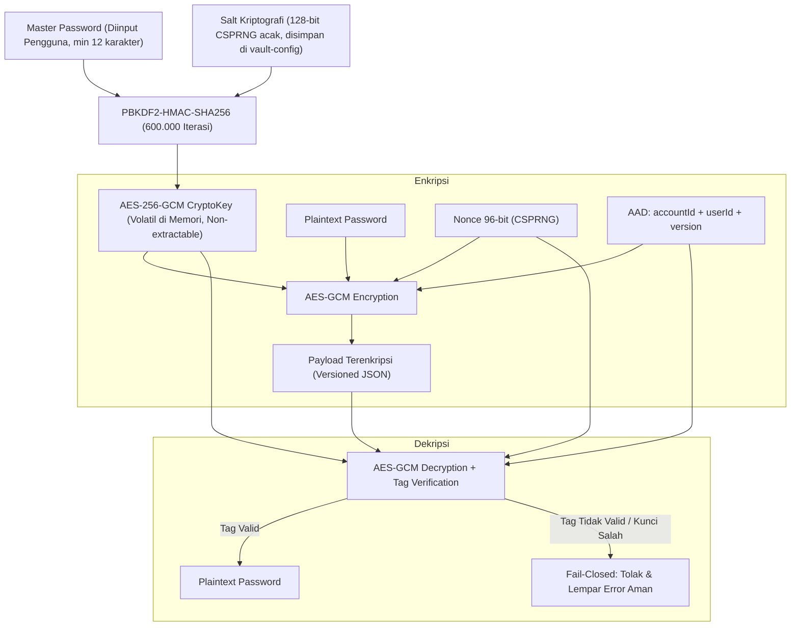

# Dokumen Keputusan Desain Kriptografi: Enkripsi Terautentikasi dan Integritas Data (AEAD)
**Proyek:** Veylora — Personal Security Assistant  
**Mata Kuliah:** Kriptografi (Tugas 2 — Milestone 2 / `kripto-v0.2`)  
**Fokus:** Perlindungan Data Sensitif Kredensial Brankas Digital (*Vault*)  
**Penulis:** Senior Cryptography & Application Security Engineer  

---

## 1. Analisis Kebutuhan Produk dan Pemodelan Ancaman (Threat Modeling)

Fitur **Vault** pada Veylora dirancang untuk menyimpan kredensial akun digital pengguna secara lokal di peramban pengguna (*zero-knowledge client-side storage*). Karena data disimpan dalam penyimpanan peramban (`localStorage`), data rentan terhadap berbagai vektor ancaman jika tidak dilindungi dengan mekanisme kriptografi yang tepat.

### Tabel Pemetaan Kebutuhan $\rightarrow$ Ancaman $\rightarrow$ Mekanisme $\rightarrow$ Alasan

| No | Kebutuhan Perlindungan Data | Skenario Ancaman (*Threat Vector*) | Mekanisme Kriptografi yang Dipilih | Alasan Pemilihan & Justifikasi Teknis |
|:---:|:---|:---|:---|:---|
| 1 | **Kerahasiaan Kata Sandi Akun (*Password Confidentiality*)** | *Data at Rest Exposure*: Akses fisik ke perangkat, ekstensi peramban berbahaya, atau eksfiltrasi file profil browser yang membaca plaintext dari `localStorage`. | Enkripsi Simetris Standar NIST: **AES-256** dalam mode **GCM** (Galois/Counter Mode). | AES-256 menyediakan tingkat keamanan 256-bit melawan serangan *brute-force* klasik maupun kuantum (*Grover's algorithm effective security 128-bit*). |
| 2 | **Integritas & Autentisitas Sandi (*Data Integrity & Authenticity*)** | *Bit-Flipping & Ciphertext Tampering*: Penyerang memodifikasi bit ciphertext di `localStorage` agar menghasilkan plaintext yang diinginkan saat didekripsi. | **AEAD (Authenticated Encryption with Associated Data)** dengan **Authentication Tag 128-bit**. | Mode GCM memverifikasi keutuhan ciphertext menggunakan Galois MAC. Modifikasi 1 bit saja akan menyebabkan verifikasi tag gagal dan operasi ditolak sebelum data diserahkan ke aplikasi. |
| 3 | **Pencegahan Pemindahan Ciphertext (*Context Binding / Anti-Swapping*)** | *Cut-and-Paste Attack*: Penyerang menukar ciphertext akun berhak akses rendah ke akun berhak akses tinggi untuk memanipulasi kredensial. | **Associated Authenticated Data (AAD)** yang mengikat `accountId`, `userId`, dan `version`. | AAD diotentikasi secara kriptografis bersama ciphertext. Jika ciphertext dipindahkan ke entitas lain, dekripsi otomatis gagal. |
| 4 | **Pencegahan Kebocoran Pola (*Indistinguishability under CPA*)** | *Replay & Pattern Analysis Attack*: Dua akun dengan kata sandi yang sama menghasilkan ciphertext yang identik jika menggunakan IV/kunci statis. | **Nonce / Initialization Vector (IV) 96-bit Unik** yang dihasilkan oleh CSPRNG untuk setiap operasi enkripsi. | Menjamin sifat *semantically secure* (IND-CPA): enkripsi berulang atas plaintext identik selalu menghasilkan ciphertext yang sama sekali berbeda. |
| 5 | **Pengamanan Master Password (*Key Derivation*)** | *Offline Dictionary Attack & Rainbow Tables*: Penyerang mencuri file konfigurasi vault dan mencoba menebak master password. | **PBKDF2-HMAC-SHA-256** dengan **600.000 Iterasi** dan **Salt 128-bit Acak CSPRNG**. | Memenuhi rekomendasi OWASP untuk *slow password hashing/KDF*, membuat serangan komputasi berbasis GPU/ASIC menjadi tidak layak secara ekonomi dan waktu. |
| 6 | **Resistensi Kebocoran Informasi (*Fail-Closed Behavior*)** | *Padding Oracle / Side-Channel Error Leakage*: Pesan kesalahan dekripsi membocorkan informasi status kunci atau struktur data. | Prinsip **Fail-Closed**: Pengembalian error generik aman tanpa membocorkan plaintext atau detail internal. | Mencegah penyerang memanfaatkan *error differentiation* untuk merekonstruksi plaintext. |

---

## 2. Mengapa Memilih AES-256-GCM Dibandingkan Alternatif Lain?

### A. Mengapa bukan Enkripsi Tanpa Autentikasi (AES-CBC atau AES-CTR saja)?
Enkripsi simetris konvensional (seperti AES-CBC tanpa HMAC) hanya menyediakan kerahasiaan (*confidentiality*), bukan keaslian (*authenticity*). Mode seperti CBC rentan terhadap:
1. **Bit-Flipping Attack**: Penyerang dapat membalik bit pada blok IV/ciphertext sebelumnya untuk mengubah nilai plaintext yang terdekripsi secara terprediksi.
2. **Padding Oracle Attack**: Jika unpadding gagal dan membocorkan pesan error berbeda, penyerang dapat mendekripsi ciphertext tanpa mengetahui kuncinya.
3. **Malleability**: Plaintext dapat dimanipulasi di bawah enkripsi tanpa terdeteksi oleh sistem.

### B. Mengapa bukan Konstruksi Manual "Encrypt-then-MAC" (AES-CBC + HMAC-SHA256)?
Meskipun *Encrypt-then-MAC* secara teoritis aman jika diimplementasikan dengan benar, pendekatan ini rawan terhadap kesalahan implementasi (*composition flaw*), seperti penggunaan kunci yang sama untuk enkripsi dan MAC, verifikasi MAC yang tidak *constant-time* (rentan *timing attack*), atau pengecekan plaintext sebelum verifikasi MAC selesai.

### C. Keunggulan AES-256-GCM (AEAD):
* **Standar Industri Teruji**: Direkomendasikan oleh NIST SP 800-38D, IETF RFC 5116, dan diadopsi dalam TLS 1.3.
* **Performa Tinggi**: Menggunakan operasi perkalian pada medan Galois $GF(2^{128})$ yang dapat diparalelkan dan diakselerasi oleh instruksi prosesor modern (AES-NI / CLMUL).
* **Single-Pass AEAD**: Mengenkripsi dan mengotentikasi data sekaligus dalam satu proses terpadu, menghilangkan risiko kesalahan komposisi.
* **Dukungan Asli Peramban**: Diimplementasikan secara native melalui Web Crypto API (`crypto.subtle`) di seluruh peramban modern dengan jaminan eksekusi terlindung di lingkungan internal mesin kriptografi peramban.

---

## 3. Komponen Kriptografi dan Fungsinya

### A. Fungsi Nonce / Initialization Vector (IV) — 96 Bit (12 Byte)
* **Tujuan**: Menghilangkan determinisme enkripsi. Nonce memastikan bahwa mengenkripsi data yang sama berkali-kali menghasilkan ciphertext yang tidak berkorelasi.
* **Spesifikasi**: Berukuran 96 bit (12 byte), panjang optimal yang direkomendasikan NIST SP 800-38D untuk mode GCM guna menghindari komputasi *GHASH initial counter*.
* **Pembangkitan**: Wajib menggunakan CSPRNG (`crypto.getRandomValues`). Dilarang keras menggunakan `Math.random()`, timestamp sekuensial, atau nilai hardcoded.
* **Aturan Mutlak Nonce-Reuse**: Nonce tidak boleh diulang (*never reused*) dengan kunci AES-GCM yang sama. Jika nonce terulang, penyerang dapat merekonstruksi kunci autentikasi (*hash key* $H$) dan memalsukan tag autentikasi pada pesan lain.

### B. Fungsi Authentication Tag — 128 Bit (16 Byte)
* **Tujuan**: Membuktikan bahwa ciphertext dan AAD belum pernah diubah oleh pihak ketiga sejak dienkripsi, serta membuktikan bahwa data dienkripsi oleh pemegang kunci yang sah.
* **Mekanisme**: Dihitung dari hasil perkalian blok-blok ciphertext dan AAD pada medan hingga $GF(2^{128})$ yang kemudian di-mask menggunakan enkripsi blok awal counter ($E_K(J_0)$).
* **Verifikasi Saat Dekripsi**: Fungsi `crypto.subtle.decrypt()` selalu menghitung tag ulang secara internal dan membandingkannya dengan tag yang disertakan. Jika terdapat perbedaan 1 bit saja, operasi dekripsi seketika membuang hasil sementara dan melempar `OperationError`. Plaintext tidak pernah dikembalikan ke memori aplikasi jika tag tidak cocok.

### C. Fungsi Associated Authenticated Data (AAD)
* **Tujuan**: Mengikat ciphertext secara kriptografis ke metadata kontekstual entri tanpa perlu mengenkripsi metadata tersebut.
* **Data yang Diikat dalam AAD Veylora**:
  ```json
  {
    "accountId": "<uuid-akun>",
    "userId": "<uuid-pengguna>",
    "version": 2
  }
  ```
* **Mencegah Context Swapping Attack**: Jika penyerang menyalin ciphertext dari Akun A milik Pengguna X dan menempelkannya ke Akun B milik Pengguna Y di `localStorage`, dekripsi pada Akun B akan menggunakan AAD Akun B. Karena AAD tidak cocok dengan yang digunakan saat enkripsi, verifikasi tag Galois MAC akan gagal total.

---

## 4. Arsitektur Pengelolaan Kunci (*Key Management Lifecycle*)



### Prinsip Keamanan Pengelolaan Kunci:
1. **Tidak Ada Kunci Statis di Kode Sumber**: Kunci tidak pernah di-hardcode di kode, tidak disimpan dalam Git, dan tidak disimpan di berkas konfigurasi.
2. **Tidak Ada Master Password di Basis Data / Penyimpanan**: Master password pengguna tidak pernah disimpan di `localStorage` maupun dikirim ke PostgreSQL.
3. **Kunci Bersifat *Non-Extractable***: Objek `CryptoKey` dibuat dengan atribut `extractable: false`, memastikan kunci tidak dapat diekspor ke dalam bentuk byte mentah melalui script eksternal di konsol browser.
4. **Masa Hidup Kunci (*Ephemeral Memory Lifetime*)**: Kunci hanya disimpan dalam memori sesi (variabel state komponen React) selama Vault dalam kondisi terbuka (*unlocked*). Begitu halaman dimuat ulang (*reload*) atau Vault dikunci kembali (*lock*), kunci seketika terhapus dari memori.

---

## 5. Struktur Penyimpanan Terstruktur (*Versioned Payload*)

Setiap entri kredensial yang dienkripsi disimpan dalam format JSON terstruktur dengan skema versi 2:

```json
{
  "version": 2,
  "algorithm": "AES-256-GCM",
  "keyDerivation": "PBKDF2-SHA256",
  "iterations": 600000,
  "iv": "<base64-encoded-96bit-nonce>",
  "ciphertext": "<base64-encoded-ciphertext>",
  "tag": "<base64-encoded-128bit-auth-tag>",
  "aadContext": {
    "accountId": "cmw6p...",
    "userId": "cmw6p...",
    "version": 2
  }
}
```

*Format ini juga kompatibel mundur (*backward compatible*) dengan muatan versi 1 (Tugas 1) dan otomatis dimigrasikan ke versi 2 saat entri diperbarui.*

---

## 6. Penanganan Kegagalan Dekripsi (*Fail-Closed Principle*)

Jika terjadi kondisi tidak sah (ciphertext rusak, nonce diubah, tag dipalsukan, AAD dimanipulasi, atau master password salah):
1. **Zero Data Leakage**: Peramban membatalkan proses dekripsi pada layer kriptografi internal. Tidak ada potongan byte plaintext yang bocor.
2. **Safe Error Handling**: Aplikasi menangkap pengecualian dan menampilkan pesan aman bagi pengguna:  
   `"Data tidak dapat dibuka karena integritasnya tidak valid atau master password tidak sesuai. Data asli tetap dipertahankan."`
3. **Data Preservation**: Data ciphertext asli yang rusak tidak ditimpa atau dihapus secara diam-diam (*silent data loss*), melainkan tetap dipertahankan di penyimpanan lokal agar tidak hilang permanen.

